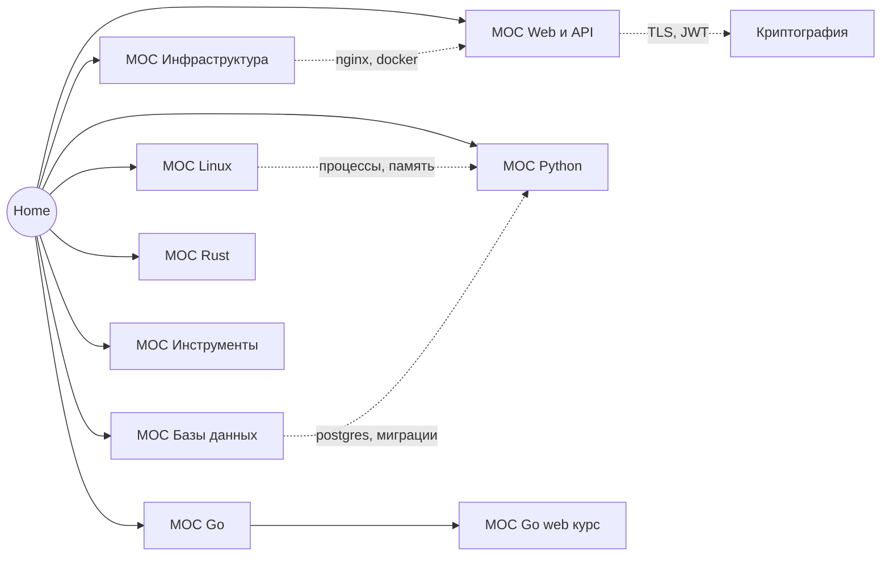

---
tags:
  - moc
aliases:
  - Главная
  - Home
---

# 🏠 База знаний

Точка входа. Каждый раздел ниже — хаб (**MOC** = Map of Content), из которого видны все заметки темы.
В графе Obsidian хабы выглядят как центры «созвездий»: фильтр `tag:#moc` покажет только карту разделов.

## Карта

## Разделы

| Раздел | О чём | Хаб |
| --- | --- | --- |
| Linux | Ubuntu, права доступа, сеть, ОС изнутри, bash | [[MOC Linux]] |
| Инфраструктура | Nginx, Docker, VPN, Android + Docker | [[MOC Инфраструктура]] |
| Web и API | HTTP, REST, curl, путь запроса, криптография | [[MOC Web и API]] |
| Базы данных | Виды БД, Postgres, порядок выполнения SQL | [[MOC Базы данных]] |
| Python | пакетные менеджеры, линтеры, тесты, инструменты, внутренности | [[MOC Python]] |
| Go | старт, модули, пакеты, компиляция | [[MOC Go]] |
| Go web курс | 12 занятий по Fiber | [[MOC Go web курс]] |
| Rust | cargo, модули, зависимости | [[MOC Rust]] |
| Инструменты | git, vim, VS Code, YAML | [[MOC Инструменты]] |

## Схемы (Excalidraw)

- [[Криптография]] — симметричное, асимметричное, гибрид, JWT, GitHub SSH
- [[АнонимныйБот.excalidraw]]
- [[Drawing 2025-04-13 11.49.36.excalidraw]]

## Соглашения

- Теги: тема (`#nginx`, `#postgres`), тип (`#cheatsheet`, `#theory`), статус (`#stub` — пустая заготовка, нужно дописать).
- В каждой заметке в frontmatter есть `up:` — ссылка на хаб, в конце — блок «Связанное».
- Имена файлов уникальны (иначе wikilinks и граф путаются): `base.md` → `Git base.md` и т.п.
