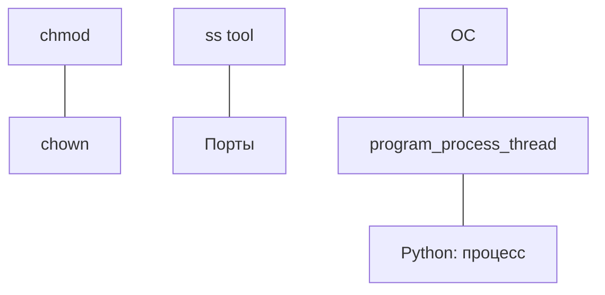

---
tags:
  - moc

up: "[[Home]]"
---

# MOC Linux

Ubuntu, права доступа, сеть, ОС изнутри, виртуалки и bash.

## Команды и утилиты

| Заметка | Суть |
| --- | --- |
| [[base_command]] | шпаргалка по командам |
| [[chmod]] | права доступа: числовой/символьный режим |
| [[chown]] | владелец и группа |
| [[ss tool]] | сокеты и соединения |
| [[Порты, и действия с ними]] | занятые порты, освобождение |
| [[журналы и чистка]] | логи, кэш APT |
| [[fish_terminal]] | оболочка fish |
| [[nano_upgrade]] | настройка nano |

## ОС изнутри

- [[OC]] — user/kernel space, память, процессы
- [[program_process_thread]] — процесс vs поток
- [[процесс]] — процессы и потоки в Python

## Виртуалки и скрипты

- [[добавить памяти к виртуалке]] — VirtualBox
- [[practice_bash_sript_create_dump]] — bash-скрипт дампа БД

## Как это связано

