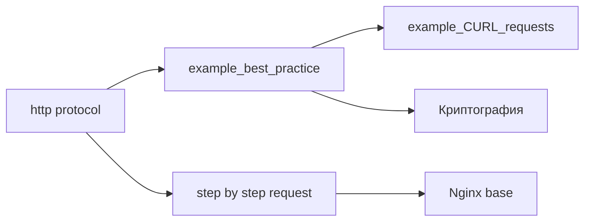

---
tags:
  - moc

up: "[[Home]]"
---

# MOC Web и API

Протокол, дизайн API, инструменты запросов и криптография.

- [[http protocol]] — структура сообщения, методы, заголовки, коды
- [[step by step request in API back & front]] — путь запроса фронт → Nginx → бэк
- [[example_best_practice]] — REST и именование
- [[example_CURL_requests]] — curl
- [[Криптография]] — шифрование, JWT, SSH

