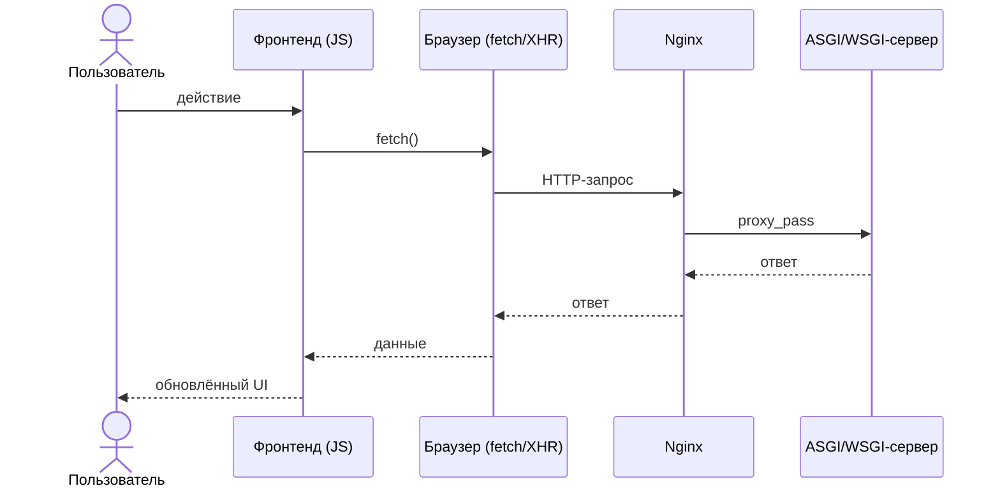

---
tags:
  - web
  - http
  - architecture
up: "[[MOC Web и API]]"
---

> [!info] Раздел: [[MOC Web и API]]

# Путь запроса, на стеке фронт react допустим и через nginx в контейнеры к python приложению

В этой схеме мы начинаем с клиента, который взаимодействует с фронтендом. Фронтенд использует API браузера для отправки запроса. Браузер отправляет HTTP-запрос на веб-сервер Nginx, который проксирует запрос на ASGI/WSGI-сервер. Сервер обрабатывает запрос и возвращает ответ обратно клиенту через Nginx. Браузер получает ответ и обновляет интерфейс фронтенда, который в свою очередь отображает обновленные данные для пользователя.



Та же схема в ASCII:

```bash
          +-----------------+
          |  Клиент         |
          |  (Пользователь) |
          +-----------------+
                  |
                  |  Взаимодействие
                  v
          +---------------+
          |  Фронтенд     |
          |  (JavaScript) |
          +---------------+
                  |
                  |  API браузера
                  v
          +-------------------+
          |  XMLHttpRequest   |
          |  или Fetch API    |
          +-------------------+
                  |
                  |  Отправка запроса
                  v
          +---------------+
          |  Браузер      |
          +---------------+
                  |
                  |  HTTP-запрос
                  v
          +---------------+
          |  Веб-сервер   |
          |  (Nginx)      |
          +---------------+
                  |
                  |  Проксирование запроса
                  v
          +---------------------------------------+
          |  ASGI/WSGI-сервер                     |
          |  (Uvicorn(FastApi)/gunicorn(Django))  |
          +---------------------------------------+
                  |
                  |  Обработка запроса
                  v
          +------------------------+
          |  ASGI/WSGI-приложение  |
          |  (Python)              |
          +------------------------+
                  |
                  |  Ответ
                  v
          +---------------------------------------+
          |  ASGI/WSGI-сервер                     |
          |  (Uvicorn(FastApi)/gunicorn(Django))  |
          +---------------------------------------+
                  |
                  |  Отправка ответа
                  v
          +---------------+
          |  Веб-сервер   |
          |  (Nginx)      |
          +---------------+
                  |
                  |  Ответ
                  v
          +---------------+
          |  Браузер      |
          +---------------+
                  |
                  |  Отображение ответа
                  v
          +---------------+
          |  Фронтенд     |
          |  (JavaScript) |
          +---------------+
                  |
                  |  Обновление UI
                  v
          +-----------------+
          |  Клиент         |
          |  (Пользователь) |
          +-----------------+
```

---

## Связанное

- [[http protocol]]
- [[Nginx base]]
- [[балансировщик]]
- [[example_best_practice]]
